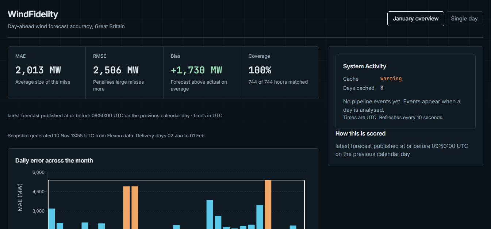

# WindFidelity

[](https://github.com/bh462007/WindFidelity/actions/workflows/ci.yml)


*January 2026 overview.*

WindFidelity answers one question for a wind-power buyer in Great Britain: **were the day-ahead wind forecasts accurate enough to buy on?** For purchase decisions made in January 2026 it shows the forecast that was available at decision time next to what the grid actually produced, and measures the error in megawatts.

**Deployed app:** _add the link here after deploying_

## What it shows

- **January overview:** month-wide MAE, RMSE and bias, a daily error chart, error by hour of day, and the error spread (median, 90th and 95th percentile, worst hour).
- **Single day:** forecast against actual for one delivery day, with the exact forecast publication that was in force at decision time.

Results for 744 delivery hours (2 Jan to 1 Feb 2026), all matched:

| Metric | Value |
|---|---|
| MAE | 2,013 MW |
| RMSE | 2,506 MW |
| Bias (forecast − actual) | +1,730 MW |
| Median absolute error | 1,606 MW |
| 90th percentile | 4,146 MW |
| 95th percentile | 5,325 MW |
| Worst hour | 6,833 MW |

The typical hour missed by about 1.6 GW, but one hour in ten missed by more than 4.1 GW, and the forecast ran above actual on average. A buyer should size risk on the tail, not the average. These figures cover one month and one definition of "actual" (see Assumptions), so they describe January 2026, not forecast quality in general.

## Assumptions

- **Decision time.** Purchase decisions are made the day before delivery, at **09:50 UTC**, my assumption of the GB day-ahead market gate closure (Nord Pool, 09:50 GMT). In January UK time equals UTC, so there is no daylight-saving handling. The brief does not name an auction, so the cutoff is configurable (`FORECAST_CUTOFF_UTC`).
- **"January".** Decisions made in January mean delivery days **2 Jan to 1 Feb 2026** (744 hours).
- **The cutoff rule.** For each delivery hour the forecast used is the latest one published **at or before** the cutoff on the previous calendar day. One published exactly at the cutoff is kept; one a second later is rejected. If none qualifies, the hour is unmatched and reported in coverage. The boundary cases are unit tested.
- **Why it matters.** With a 12:00 UTC cutoff, forecasts published after the market closed leak in and make the error look about 6% smaller (MAE 1,901 MW against 2,013 MW).
- **Actuals.** Elexon FUELHH, fuel type `WIND`, half-hourly values averaged to hourly. Only hours with both half-hours present are scored.
- **Forecasts.** Elexon WINDFOR. Duplicate timestamps keep the last value and log a warning if the values conflict.
- **Bias sign depends on the definition of "actual".** The reported bias is relative to FUELHH wind. It shows how the forecast compares with that series, not that the forecast is biased, because the WINDFOR documentation does not say whether embedded wind is included.
- **Only the two datasets named in the brief are used.**

## Data and the snapshot

The deployed app serves a **snapshot** of January 2026 (`backend/data/january_2026.json`) produced by the same pipeline as the live API. This keeps the demo fast and independent of Elexon being reachable. The dashboard states when the snapshot was generated. To rebuild it from live data:

```powershell
python scripts/build_snapshot.py
```

The live pipeline needs two Elexon calls for any period: one FUELHH request and one WINDFOR request (`/datasets/WINDFOR/stream` with a publish-time window).

## API

| Endpoint | Returns |
|---|---|
| `GET /api/v1/snapshot` | The stored January 2026 analysis |
| `GET /api/v1/period?start=&end=` | Live analysis for a date range (max 62 days): metrics, daily, hourly, percentiles, points |
| `GET /api/v1/summary?day=` | Live metrics for one day |
| `GET /api/v1/timeseries?day=` | Live per-hour forecast, actual and publish time |
| `GET /api/v1/activity?limit=50` | Recent pipeline events, newest first |
| `GET /health`, `GET /ready` | Liveness; `warming` until a day or period has been cached |

Every response has a typed Pydantic model. Errors use one envelope:

```json
{ "error": { "code": "no_data", "message": "..." } }
```

| Status | Code | Meaning |
|---|---|---|
| 503 | `upstream_unavailable` | Elexon could not be reached |
| 503 | `snapshot_unavailable` | The stored snapshot is missing or unreadable |
| 422 | `no_data` | No matching forecasts and actuals |
| 422 | `invalid_request` | Malformed or out-of-range parameter |

Live results are cached in memory for 5 minutes. The System Activity panel lists real pipeline events from the backend (rows ingested, hours matched, cache hits and misses, failures). It polls rather than streams, so it is not labelled "live".

## Files and directories

```
backend/
  app/
    api/            routes: metrics (summary, timeseries, period, snapshot), activity, health
    ingestion/      Elexon client (retries, timeout) and record validation
    processing/     clean, match (the cutoff rule), metrics, breakdown (daily, hourly, percentiles)
    services/       analysis pipeline, snapshot, TTL cache, activity ring buffer
    models/         Pydantic response models
    frontend.py     serves the built frontend when present
    config.py       cutoff and paths from environment variables
  data/             january_2026.json (the snapshot)
  tests/            unit and integration tests
frontend/
  src/
    api/            typed client
    components/     overview, day view, charts, error spread, states, System Activity
    hooks/          snapshot and activity loading
    lib/            downsampling, chart data, decision-time helpers
scripts/            build_snapshot.py, fetch_sample.py
Dockerfile          builds the frontend, serves everything from one image
index.py            Vercel entrypoint
vercel.json         Vercel configuration
.github/workflows/  CI: lint, tests, build, and a Docker smoke test
```

## Running it

### Docker

```powershell
docker build -t windfidelity .
docker run -p 8000:8000 windfidelity
```

Open http://localhost:8000.

### Local development

You need Python 3.11 or newer and Node 20 or newer.

```powershell
python -m venv .venv
.\.venv\Scripts\Activate.ps1
pip install -r requirements.txt
cd backend
python -m uvicorn app.main:app --port 8000
```

In a second terminal:

```powershell
cd frontend
npm install
npm run dev
```

Open http://localhost:5173. The dev server proxies `/api` and `/ready` to the backend.

### Configuration

| Variable | Default | Meaning |
|---|---|---|
| `FORECAST_CUTOFF_UTC` | `09:50` | Decision time on the day before delivery |
| `FRONTEND_DIST` | `frontend/dist` | Built frontend to serve, if present |
| `PORT` | `8000` | Port inside the Docker image |

## Tests and checks

```powershell
python -m pytest -q          # backend, from the repository root
python -m ruff check backend

cd frontend
npm test
npm run build                # also type-checks
npm run lint
```

CI runs all of these on every push, then builds the Docker image and checks the running container (`/health`, `/api/v1/snapshot`, and the frontend page).

## Design decisions

- **The cutoff is a function parameter**, not a hidden global, so it can be tested, shown in the UI and compared.
- **One WINDFOR request per analysis**, limited to the publish window that can matter, so nothing published after the cutoff is even downloaded.
- **Percentiles use the nearest-rank method**, so every reported percentile is an error that actually occurred.
- **Actuals come from FUELHH.** An earlier version used a per-type endpoint where a keep-last dedupe silently dropped onshore wind and inflated the error; it was caught by comparing the pipeline with the raw data.
- **Chart rendering is capped at 500 points** using largest-triangle downsampling, which keeps peaks.

## Limitations

- One month, one cutoff assumption, one definition of "actual".
- The activity log and cache live in the backend process and reset on restart.
- The snapshot is static. Refresh it with `scripts/build_snapshot.py`.
